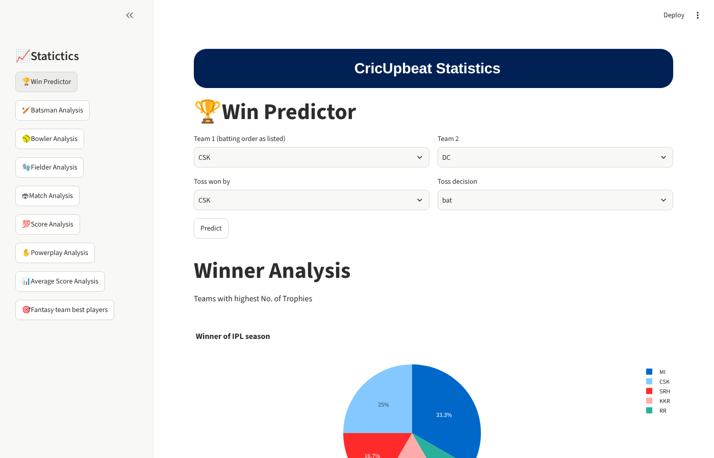
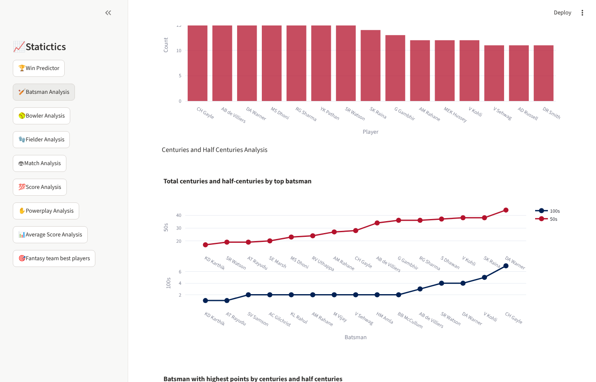

# 🏏 CricUpbeat Analysis: IPL Statistics & Win Predictor

An interactive **Streamlit** dashboard that analyses **12 IPL seasons (2008–2019)**: 756 matches and about 180,000 ball-by-ball deliveries. It includes a **logistic-regression win predictor**.

It was built as the analytics extension of the *CricUpbeat* cricket-scoring app.

| Win predictor | Batsman analysis |
|---|---|
|  |  |

## ✨ What's inside

| Section | Highlights |
|---|---|
| 🏆 **Win Predictor** | Pick two teams, the toss winner and toss decision, and get a **win probability** from a one-hot logistic regression. Hold-out accuracy is shown honestly. |
| 🏏 **Batsman Analysis** | Centuries, half-centuries, strike rates, top six and four hitters, radar comparison of the best batsmen |
| 🥎 **Bowler Analysis** | Wickets, economy bands, maidens, 4- and 5-wicket hauls |
| 🧤 **Fielder Analysis** | Catches, run-outs, stumpings |
| 🏟 **Match Analysis** | Win % by team, venues, umpires, toss impact |
| 💯 **Score / Average / Powerplay** | Run distributions, chasing success, powerplay scoring and dismissals |
| 🎯 **Fantasy XI** | Best players by a combined batting, bowling and fielding score |

## 🚀 Run locally

```bash
git clone https://github.com/vijay2834/CricUpbeat-Analysis.git
cd CricUpbeat-Analysis
pip install -r requirements.txt
streamlit run cricupbeat.py
```

The data (`matches.csv`, `deliveries.csv`) is in the repo, so no download is needed.

### Deploy for free

Push to GitHub, then go to [share.streamlit.io](https://share.streamlit.io), click **New app**, and choose this repo with `cricupbeat.py`.

## ✅ Tests

```bash
python -m pytest tests -q     # 11 headless tests via streamlit.testing.AppTest
```

The tests click every sidebar section and assert that it renders without exceptions, and check that the predictor returns a probability. CI runs them on every push.

## 🔧 2026 refresh

- Upgraded from Streamlit 0.64, pandas 1.0 and plotly 3 to current versions (`st.cache_data`, `plotly.subplots`, pandas 2 `value_counts` semantics).
- **Fixed win-percentage chart:** wins were aligned to teams by row position, so the numbers belonged to the wrong teams.
- **Replaced the old predictor**, which displayed a random 57–63% "chance", with a real probabilistic model.
- Data loads from local files instead of GitHub raw URLs. Heroku config (free tier discontinued) is replaced by Streamlit Cloud instructions.

## 🛠️ Tech stack

Python · Streamlit · pandas · NumPy · Plotly · scikit-learn · pytest
